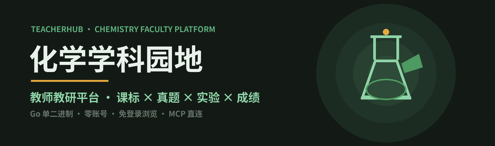
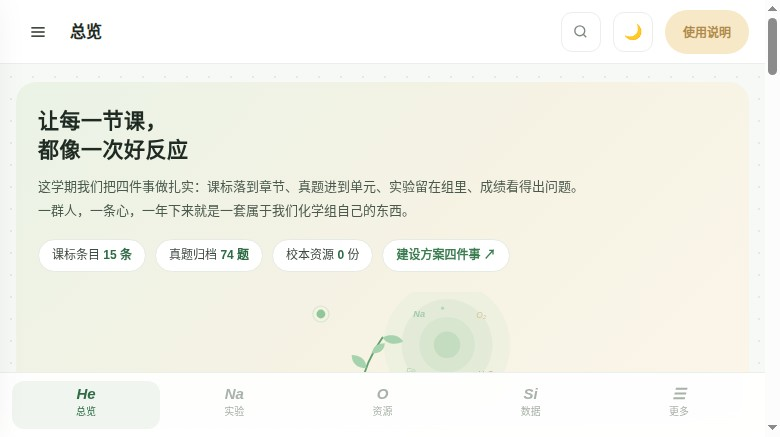
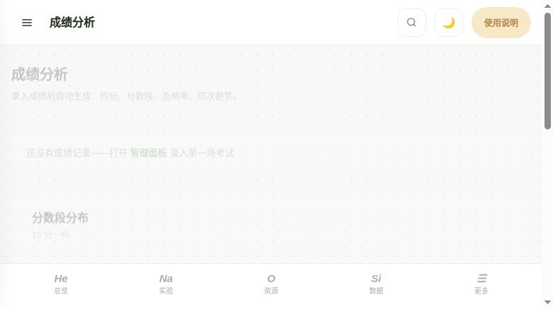

<p align="center"></p>

# teacherhub —— 化学学科园地 · 教师教研平台

**给化学教研组的云端工作台**：课标映射、真题归档、实验模拟、成绩分析、资源共享——一套系统管到底。老师免登录打开即用，管理一把 key，AI 客户端走 MCP 直连。

<p align="center">


</p>

<p align="center">
 
</p>

## 它解决什么问题

| 层 | 负责 | 换掉它意味着 |
|---|---|---|
| **学科园地门户** | 课标/真题/实验/成绩/资源五个模块一屏管理 | 老师在五个 Excel 和一个群文件之间来回找 |
| **实验工作台** | 一实验一模块的课堂模拟器（参数可调/逐帧回看/投屏） | 危险实验做不了、失败对照组讲不清 |
| **成绩分析** | 均分→分数段→**逐题失分排行**→CSV 导出 | 月考分析会只看均分，说不出该补哪道题 |

## 亮点

- 🧪 **零账号**：浏览/下载/看统计全免登录，写操作一把统一 key（支持轮换），链接发群里点开即用
- 📉 **看得出问题**：成绩三段分析（均分/分数段/逐题失分率排行），失分重灾区红色标注
- 🤖 **MCP 直连 17 工具**：AI 客户端可检索产物、录成绩、查失分、传文件（读免 key / 写留 key）
- 📱 **手机即用**：拍照上传试卷/板书、PWA 加主屏、元素速达导航、44px 触控
- 🔒 **安全红线**：文件名净化防穿越、nosniff 防 XSS、限速限大、gzip 语义精确
- 💾 **数据不丢**：自动备份（24h 轮转 7 份含共享文件）+ 手动快照 + 全量导出 + 操作日志留痕

## 快速开始

```bash
# 云端（一台便宜 VPS 即可，单二进制零依赖）
./teacherhub serve --addr :8096 --data ./data          # 首次自动生成统一 key
systemctl enable --now teacherhub                      # 或直接跑

# 本地 CLI（老师的电脑）
./teacherhub config                                     # 配置云端地址/姓名/key
./teacherhub search "钠与水"                            # 检索复用，不重复生成
./teacherhub push --title "..." --content-file lab.html # 产物上云拿链接
```

管理后台 `https://你的域名/admin`（输 key 进入，七板块：总览/内容/成绩/课标/互动/备份/日志）。

## 功能一览

| 模块 | 内容 |
|---|---|
| **实验工作台** | 一实验一模块单文件 HTML（钠与水/铁丝燃烧/过氧化氢/凸透镜），参数耦合/预设对照/截图/投屏/快捷键/CSV |
| **成绩分析** | 录入（分数+逐题统计）→ 均分/极值/及格率/分数段柱状/逐题失分排行/历次趋势 → CSV 导出 |
| **课标地图** | 人教版五模块四级映射（课标→章节→真题→资源），认领制推进 |
| **真题库** | 2021—2026 六年高考化学卷型结构归档 |
| **资源库** | 文件上传下载（免 key 署名/限速/净化/attachment+nosniff）+ 拍照上传 |
| **管理后台** | 七板块 + 操作日志（滚动 500 条）+ key 轮换 + 备份管理 |
| **集成** | MCP 17 工具 · RSS · PWA · 扫码分享 · 全局搜索智能分流 · gzip 71% |

## 架构

```
老师的电脑（纯本地）                     云端（VPS / 内网机）
┌─────────────────────────┐            ┌──────────────────────────┐
│ WorkBuddy 插件（SKILL）   │   统一key  │ teacherhub serve          │
│  ├ teacherhub CLI        │ ─────────► │  ├ 学科园地门户（SPA）     │
│  ├ 配置 WebUI            │  检索/推送  │  ├ 管理后台 /admin        │
│  └ 实验模板 + 参数配方     │            │  ├ MCP /mcp · RSS /feed  │
│ 生成在本地，产物自动推云端 │            │  └ 备份/日志/文件存储      │
└─────────────────────────┘            └──────────────────────────┘
     访问政策：浏览 GET/HEAD 免 key · 写操作留 key · 评分/留言免 key 限速
```

技术底座：**Go 纯标准库零依赖**（约 3850 行 / 34 路由），前端零依赖手写内联，产物永远单文件 HTML。

## 云端部署

```bash
./teacherhub serve --addr :8096 --data /var/lib/teacherhub   # key 自动生成或 --key 指定
# 验收：curl "http://IP:8096/api/ping?key=XXX" → {"ok":true}
```

- 放行端口 8096（安全组/防火墙）；有域名建议挂 HTTPS 反代（nginx/caddy）
- 换 key：后台一键轮换（旧 key 即时作废），或重启时换 `--key`
- 数据全在 `--data` 目录（store.json + artifacts/ + files/ + backups/），备份这一个目录=备份全部

## 教师端（WorkBuddy 插件）

把 `plugins/workbuddy/teacherhub/` 拷进 `~/.workbuddy/skills/`（Windows 是 `C:\Users\你\.workbuddy\skills\`），重启 WorkBuddy。首次 `teacherhub ui` 填三样配置，之后动嘴完成：「帮我做个钾与水反应的实验工作台」→ 检索 → 复用/生成 → 自动推送 → 发链接。

## 检索相似度说明

中文友好的二元切片重叠：查询词与「标题×2 + 标签 + 关键词 + 简介」比对，动态阈值命中，按相似度排序；查询串完整出现在标题里直接满分。同一个实验换个说法搜（「钠和水」vs「钠与水反应」）也能命中。

## 安全口径

- 上传面：文件名净化（拦路径分隔符/控制字符，点号合法）+ 50MB 限大 + 每小时 10 个限速 + 磁盘名与用户输入解耦
- 下载面：`attachment` + `X-Content-Type-Options: nosniff`（上传的 HTML 永远只下载不渲染）
- 鉴权：统一 key 32 位只存 store.json（0600），一键轮换旧 key 即时失效；管理操作全部留痕（滚动 500 条）
- 公开写入（评分/留言/文件）免 key 但限速限频；成绩原始分只进统计不出站（CSV 导出要 key）

## 目录结构

```
teacherhub/
├── main.go / cloud.go / admin.go / portal.go / mcp.go / ui.go / qr.go
│        # 单二进制双角色：serve（云端）+ CLI（本地）；qr.go 为自写迷你 QR 编码器
├── web_dashboard.html          # 学科园地门户（11 视图 SPA，深色/移动端/元素主题）
├── scripts/probe_teacherhub.sh # 全量探针（107 断言：鉴权/文件/成绩/gzip/备份/MCP/重置）
├── plugins/workbuddy/teacherhub/  # WorkBuddy 插件包（SKILL + 四平台 CLI + 实验模板）
└── docs/shots/                 # README 截图素材
```

## 开发与测试

```bash
go build ./... && go vet ./...
go build -o /tmp/teacherhub-bin .
bash scripts/probe_teacherhub.sh    # 99 断言全绿
```

发布门禁：探针全绿 + vet 干净 + 三平台产物架构核验（file/sha256/实跑自报版本）。

## 设计取舍

- **零账号而非多账号**：教研组场景全员互信，账号体系只增加摩擦；权限粒度用"读免写留"两档覆盖，删除类操作留痕可追。
- **产物=单文件 HTML**：老师双击能开、发群里能看、十年后还能读；不用运行时框架。
- **锁内 save**：单机低并发场景简单可靠（评审定性：设计如此）。

## License

MIT
